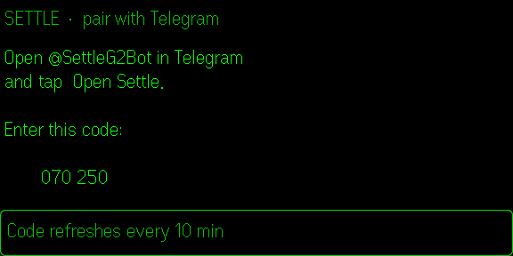
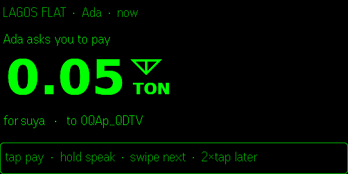
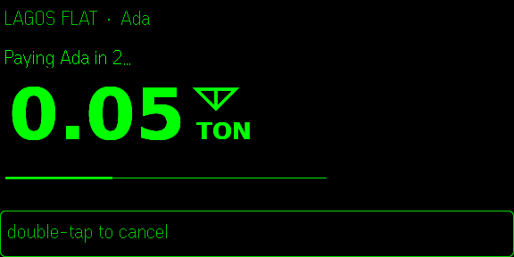
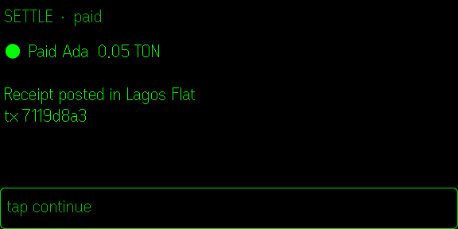
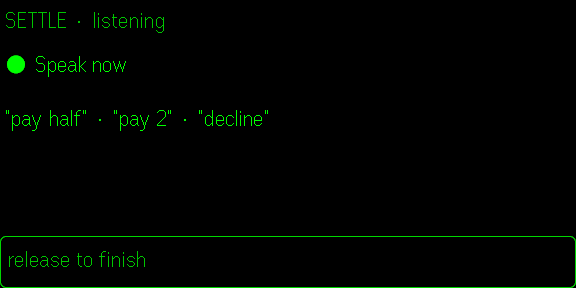

# Settle: Telegram money requests, paid from your Even G2 glasses

**Heads Up: Even Realities Hackathon (DoraHacks) · Track 01 Messaging & News + Track 02 Crypto & DeFi (Gram/TON) · Best Telegram integration**

A friend posts in your Telegram group: *"@victor you owe me 1.5 TON for the suya"*.
Your G2 shows one card: **who, how much, what for**. You tap once. Three seconds later the payment is on TON (testnet), and a receipt with an explorer link is posted back as a reply in the group. Your phone never leaves your pocket.

| Pair | Request | Pay (3 s to cancel) | Paid |
|---|---|---|---|
|  |  |  |  |

## The problem
Group chats are where small debts happen: rent shares, fuel for the generator, dinner, a data plan someone topped up for everyone. In Telegram the request scrolls away, and paying means: find the message, open a wallet, copy an address, type the amount, come back, say "sent". Most people forget, and someone has to chase. Telegram already has a native wallet, so the money is right there. What's missing is the moment of action.

**Who it is for:** people who live in Telegram groups (flatmates, teams, communities) and already use TON / the Gram wallet in Telegram, especially where Telegram is the default way people coordinate and money moves.

## How it works (read and write)
1. **Read.** The Settle bot sits in your group. When a message looks like a money request, a small model turns it into a structured request: payer(s), amount per person, memo. It handles splits ("split 6 TON between me, @a and @b" becomes 2 TON each) and replies ("send me 2 TON for tickets" in reply to you). Anything that isn't a request is ignored, and only messages that pass a cheap money-word and amount check ever reach the model.
2. **Glance.** If the request is for you, it appears on your G2 as one card, with the amount drawn in large type (rendered into an image container, because the system font has one size).
3. **Act.**
   - **Tap** pays. A 3-second countdown follows, and a **double-tap** cancels it.
   - **Hold and speak** a short phrase: "pay half", "pay 2", "decline", "later".
   - **Swipe** moves to the next request, **double-tap** snoozes it.
4. **Close the loop.** The transfer goes out on TON testnet with the memo as a comment. The bot replies to the original message with a receipt and a Tonviewer button, so nobody has to ask "did you send it?".

Setup happens in a **Telegram Mini App** (the bot's *Open Settle* button). You pair the glasses with a 6-digit code (Google sign-in does not work in the Even WebView, and Telegram's own login is better anyway), set where you get paid, and see your limits and recent receipts. The Mini App runs in two modes:
- **Static** (default, hosted on GitHub Pages: https://connex123.github.io/settle-g2/miniapp/). The bot opens it from a keyboard button, with your state in the URL fragment. Changes go back through `Telegram.WebApp.sendData`, which Telegram delivers to the bot over the same long-polling connection, so the server needs **no inbound HTTPS at all**.
- **Served by the Settle server** (`/miniapp/`, when `PUBLIC_URL` is set). It talks to the server API and is authenticated with `initData` (HMAC).

Without the Mini App, `/pair 123456` in a private chat with the bot works too. Payees can just send `/wallet <address>` in the group.



## Architecture
```
Telegram group ──► Settle bot (Bot API, long polling)
                        │  money-word gate → Claude Haiku extractor (rules fallback)
                        ▼
                  Settle server (Node, no framework) ── TON testnet (toncenter, @ton/ton, one demo wallet)
                   │ HTTP long-poll state, pay/decline, voice           │
                   │                                                    └─► receipt reply in the group
         ┌─────────┴──────────┐
   G2 app (Even Hub SDK,     Telegram Mini App (pairing, payout address,
   Vite + TS, in the Even     limits, receipts; auth = Telegram initData HMAC)
   app WebView)
   mic PCM ─► server ─► local faster-whisper (no audio leaves the server)
```
- `app/`: the glasses app. `src/screens.ts` is a pure screen model (header, body, footer) fitted to 576×288. `src/main.ts` is the controller: SDK events, long press for voice, countdown. `src/bigtext.ts` draws the large amount to PNG for the image container.
- `server/`: `telegram.js` (bot, request creation, receipts, Mini App auth), `parse.js` (gate, model, rules), `ton.js` (wallet, serialised transfers, tx hash lookup), `voice.js` + `stt/whisper_worker.py` (speech-to-text), `store.js` (small JSON store).
- `miniapp/`: a single HTML file using `telegram-web-app.js` and the Telegram theme colours.
- `scripts/`: headless simulator runner, a fake Telegram Bot API for offline tests, and an end-to-end simulator driver.

## Safety and privacy
- **Testnet only.** One demo wallet held by the server, for the hackathon. The production path is TON Connect / the Gram wallet signing on the user's phone. Settle would then only prepare the transfer and never hold keys.
- **Nothing pays on its own.** Every payment needs a tap or a spoken "pay", followed by a 3-second cancel window.
- **Hard caps:** per payment (default 2 TON) and per day (default 5 TON), plus a balance check.
- Only the person a request names can pay it, and only from glasses paired to their own Telegram account. The Mini App verifies Telegram `initData` (HMAC-SHA256 with the bot token, 24 h max age).
- **Message text is never stored.** Only the parsed fields are kept: amount, memo, chat title, ids. Chat text goes to the model as data, with an instruction not to follow it, and is capped at 500 characters.
- Voice is transcribed locally with faster-whisper, so no audio goes to a third party.
- **No keys in the app.** The app only talks to the Settle server, which is the single entry in the `app.json` network whitelist. Secrets live in files outside the repo (see below).

## Run it
Requirements: Node 20+, Python 3.10+ with `pip install faster-whisper numpy` (only for voice).

```bash
npm --prefix app install && npm --prefix server install
# secrets: files outside the repo, or env vars
#   TELEGRAM_BOT_TOKEN   (from @BotFather; disable privacy mode with /setprivacy so the bot sees group messages)
#   TON_MNEMONIC         (24 words of a TESTNET V4 wallet; fund it at https://faucet.ton.org via actonscan.com/faucet)
#   ANTHROPIC_API_KEY    (optional; without it the rules parser is used)
#   PUBLIC_URL           (HTTPS origin of this server, for the Mini App button)
npm run server                    # :8787
npm --prefix app run dev          # :5173
evenhub-simulator http://localhost:5173
```
Set `VITE_SETTLE_API` when building the app if the server is not on `localhost:8787`.

**Live with a real bot:** put the token in `/home/box/secrets/settle-telegram-bot.token` (or `TELEGRAM_BOT_TOKEN`), set privacy mode off in @BotFather (`/setprivacy` → Disable, then re-add the bot to the group), and run `npm run server`. `scripts/run-live.sh` can add a cloudflared quick tunnel if you want the server-hosted Mini App.

**No Telegram account handy?** `./scripts/dev-stack.sh` starts a local fake Telegram Bot API (with a chat view at http://localhost:8081), the server and the simulator. Then `PAYEE_ADDR=<testnet address> node scripts/sim-flow.mjs` drives the whole flow (pair, group request, tap, real testnet transfer, receipt) and saves glasses screenshots. `npm test` runs the unit tests.

## Built during the hackathon
All code in this repo was written during the build week (from 25 Nov 2026). What existed before 23 Nov and is used here:
- npm and pip dependencies: `@evenrealities/even_hub_sdk`, the Even Hub simulator and CLI, Vite, TypeScript, `@ton/ton` / `@ton/core` / `@ton/crypto`, `faster-whisper`.
- Telegram Bot API, the Telegram Web App script, toncenter testnet API, Anthropic Messages API.
- Before 23 Nov there was only a written design note and a check that the simulator runs headless. No app code.

## API feature requests (for the teams behind the APIs)
1. **Even Hub:** a way for a plugin to raise a small glanceable alert while it is backgrounded (opt-in, rate-limited). A money request is exactly the kind of thing worth one line on the lens.
2. **Even Hub:** a larger font size (or a numeric display font) for text containers, so amounts do not have to be rendered as images.
3. **Telegram Bot API:** a "payment request" message type (amount, asset, payee) that clients render natively and bots can read and resolve.
4. **TON Connect / Gram wallet:** pre-authorised small payments (a per-app allowance the user sets once), so a wearable confirm can sign without bouncing to the phone.
5. **Simulator:** IMU simulation, so nod-to-confirm style input can be tested without hardware.

## Track
Main: **01 Messaging & News (Telegram)**. Second: **02 Crypto & DeFi (Gram wallet / TON)**, because the core flow connects both. Also entered for **Best Telegram integration**.

## License
MIT
